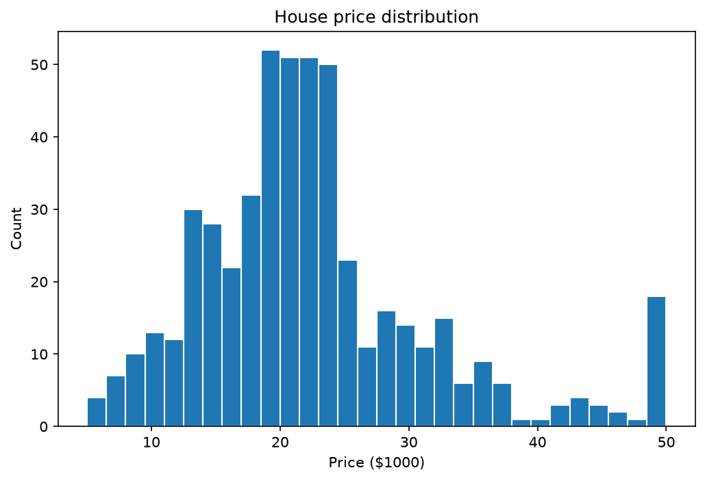
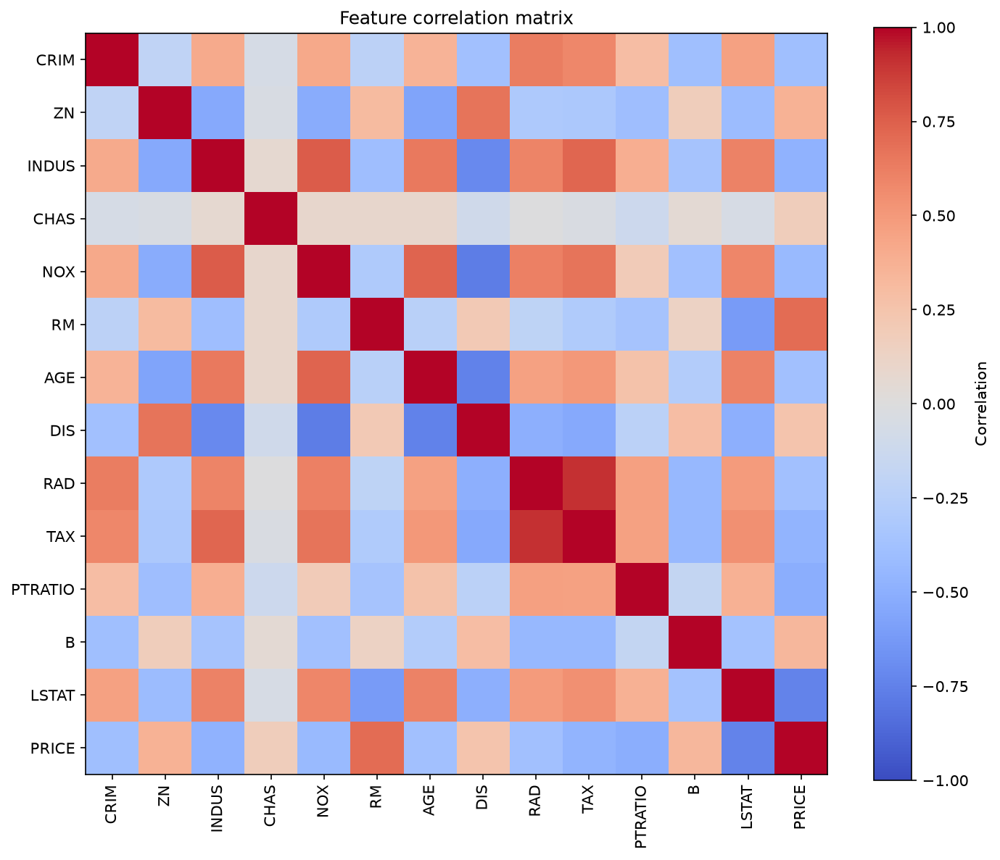
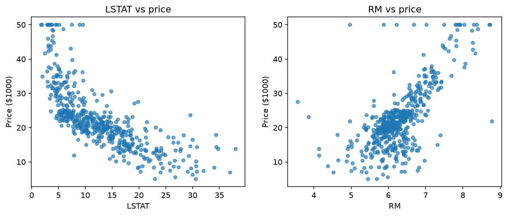

# Boston Housing Analysis with scikit-learn

This project demonstrates a small, reproducible regression workflow for the
Boston housing dataset: data loading, tabular analysis, optional EDA plots,
and comparison of linear, Ridge, and Lasso regression.

The dataset is loaded from OpenML because `sklearn.datasets.load_boston` was
removed from scikit-learn. The first run requires network access to download
the cached dataset.

## Run

```bash
python -m pip install -r requirements.txt
python boston_house_sklearn.py
python boston_house_sklearn.py --plots
```

By default, the command writes results to `outputs/`. To use another location,
pass the `--output-dir` option:

```bash
python boston_house_sklearn.py --plots --output-dir artifacts
```

The generated files are:

- `dataset_summary.csv`: descriptive statistics, missing-value counts, and data
  types for every column
- `model_results.csv`: test and cross-validation metrics for each regression
  model
- `plots/`: EDA images, generated only when `--plots` is supplied

## Current EDA







## Modules

- `data.py`: loading and validating features and target
- `analysis.py`: quality summaries and correlations
- `eda.py`: optional matplotlib visualizations
- `modeling.py`: reproducible train/test and cross-validation evaluation
- `boston_house_sklearn.py`: command-line entry point
